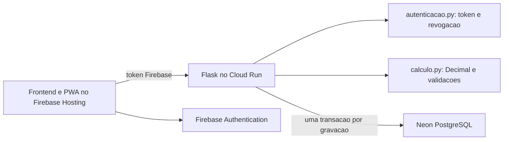

# Revisão de segurança, funcionamento e manutenção — 04/10/2026

A revisão cobriu os quatro módulos Python de produção, sete scripts JavaScript,
HTML/CSS, PWA, autenticação, contratos HTTP, consultas/transações, configuração do
banco, Docker, Hosting, scripts de publicação, workflows e testes. Backups,
dependências instaladas e artefatos gerados não são fontes de execução do app.

## Correções

- Verificação Firebase isolada em `autenticacao.py`; importação sem conexão ao banco.
- Respostas de erro não expõem detalhes do PostgreSQL. Logs internos preservam o
  diagnóstico. Corpo limitado a 16 KB e cabeçalhos contra interpretação indevida
  de conteúdo e enquadramento. Tokens continuam verificados com revogação e allowlist.
- Cadastro legado de datas também adquire o lock anual. Criação usa INSERT com
  conflito sem sobrescrita; edição usa UPDATE somente se os valores mudaram.
- Prazo de sete dias, lançamento único, comparação dos valores originais, datas
  livres e rollback de origem/destino preservados. Sem migração de dados.
- Banco limita comandos a 20 segundos e espera por locks a 10 segundos, além do
  timeout de conexão. Nenhuma tarefa em segundo plano ou polling adicionados.
- Taxa limitada a 0–100%, seis casas na fração (quatro no percentual), evitando
  entradas desproporcionais. Campo omitido/em branco e taxa igual continuam sem escrita.
- Autorização no navegador tem timeout e botão de nova tentativa; senha apagada
  após login/logout. Logout invalida consultas e respostas de gravações pendentes.
- Dependências diretas fixadas; Click atualizado de 8.3.1 para 8.3.3, corrigindo
  CVE-2026-7246. `pip-audit -r requirements.txt` sem vulnerabilidades conhecidas.
- Container usa usuário sem privilégios. `.gcloudignore` inclui somente seis
  arquivos necessários; `.env`, backups, testes, logs e allowlists locais não vão
  ao build. `.gitignore` também protege artefatos privados e gerados.
- Hosting aplica CSP, proteção contra frames, nosniff, política de referência e
  restrição de câmera/microfone/localização. Worker atualizado para v22-security-review.
- Workflows corrigidos: testes JS, diretório correto, live apenas por execução
  manual. `publicar-atualizacao.ps1` usa revisão sem tráfego e preserva configuração.
- Código Python formatado e lint configurado; cópias do frontend conferidas por hash.
  Backup dos arquivos alterados em `backups/auditoria-20261004/`.

## Arquitetura preservada

O Hosting contém somente arquivos públicos. Cloud Run recebe DATABASE_URL do
Secret Manager. GETs financeiros não escrevem; alterações/deleções recalculam os
agregados com locks. Não foi criada uma nova camada de infraestrutura.

## Verificação e limites

52 testes Python e cinco testes JavaScript passaram. Integração usa tabelas TEMP
e sequências temporárias, sem modificar registros reais. Lint, formato, importação,
sintaxe JS, instalação e auditoria das dependências aprovados. Uma revisão de
código e scanners não garantem ausência absoluta de bugs ou vulnerabilidades.

## Custos do Cloud Run

Conferido em https://cloud.google.com/run/pricing em 04/10/2026: para cobrança por
requisição, franquia nominal mensal de 180.000 vCPU-segundos, 360.000 GiB-segundos
e 2 milhões de requisições. Compartilhada entre projetos por conta de faturamento,
renovada mensalmente e aplicada como desconto baseado nos preços Tier 1 de
us-central1. São Paulo tem preço regional próprio; os números não garantem custo
zero. Build, armazenamento de imagens, rede e serviços externos têm regras próprias.

Configuração observada antes da revisão: 1 vCPU, 512 MiB, concorrência 8,
máximo 3 instâncias, conta de serviço existente, cobrança por requisição padrão.
Esses recursos e os segredos foram preservados na atualização.

## Publicação concluída

- Cloud Run: revisão `financeiro-tony-lanches-00006-cax`, promovida a 100% após
  teste sem tráfego. Anterior: `financeiro-tony-lanches-00005-2q8`.
- Hosting: versão `5f46068167084e66`, publicada em 04/10/2026 às 03:46:45 UTC.
  App: https://financeiro-tony-lanches.web.app.
- API `/health`: 200; rotas financeiras sem token e token inválido: 401;
  preflight CORS de edição/exclusão: 204 na origem autorizada.
- 15 arquivos públicos comparados por SHA256 com os locais: todos idênticos;
  cabeçalhos de segurança presentes. Evidência: `verificacao-publicacao-20261004.json`.
- Navegador com perfil novo: login carregado, botão habilitado, sem erro JavaScript
  ou bloqueio CSP. Não foi realizado login com credenciais válidas nem lançamento
  financeiro real durante a verificação de produção.
- `/healthz` retorna 404 na camada externa do Cloud Run, inclusive na revisão
  anterior: caminhos terminados em `z` são reservados. Usar `/health` externamente.
  Referência: https://cloud.google.com/run/docs/known-issues.
- Recursos, segredos, conta de serviço e permissões existentes preservados.
  Registro completo e rollback: `../contexto_ideia.md`.

## Correção posterior: compatibilidade do pooler

A verificação inicial não cobriu o endpoint pooled: a suíte TEMP troca para conexão
PostgreSQL direta. O pooler rejeitou os parâmetros `statement_timeout`/`lock_timeout`
injetados no pacote de conexão, causando HTTP 500 nas consultas reais. A injeção
foi retirada. O runner agora executa três GETs de leitura com o endpoint configurado
antes da troca para TEMP; eles passaram inclusive com o segredo exato de produção.
52 testes passaram novamente. Resultado da republicação em `contexto_ideia.md`, seção 25.
